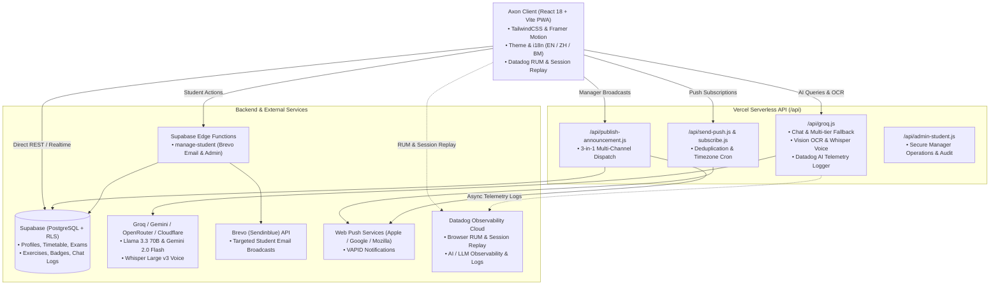

# Axon

<div align="center">


**Next-Generation AI-Powered Student Productivity & Academic Management Platform**

[](https://react.dev/)
[](https://vitejs.dev/)
[](https://tailwindcss.com/)
[](https://supabase.com/)
[](https://groq.com/)
[](https://www.datadoghq.com/)
[](https://developer.mozilla.org/en-US/docs/Web/API/Push_API)
[](LICENSE)

</div>

---

## Overview

**Axon** is an all-in-one Progressive Web Application (PWA) engineered to streamline university life, academic planning, habit tracking, and administrative oversight. Built originally for students of **Tunku Abdul Rahman University of Management and Technology (TAR UMT)** and scalable to any higher education institution, Axon fuses real-time database synchronization with an **Autonomous AI Study Companion**, multi-provider multimodal vision OCR, gamified fitness tracking, full-stack **Datadog Observability**, and a comprehensive **Manager Portal**.

Deployed natively on **Vercel** with a serverless API backend, **Supabase** (PostgreSQL, Auth, RLS, Realtime, Edge Functions), and **Groq / Google Gemini** AI infrastructure, Axon delivers sub-second response times across desktop, tablet, and mobile devices.

---

## System Architecture



---

## Core Features

### 1. Student Workspace

- **Intelligent Timetable Engine**:
  - Weekly interactive schedule grid supporting Lecture (`L`), Tutorial (`T`), Practical (`P`), and Class (`C`) course types.
  - **Dynamic Day Filtering**: Automatically displays only days with scheduled classes, including full Sunday class support.
  - Multi-timetable profile management with an **Automatic Semester Rollover Wizard** preserving historical archives while initializing new semesters.
  - **AI Screenshot OCR Import**: Two-pane workspace with live weekly preview, automated course code detection, and smart review cards before saving.
  - Semester end auto-pause for notifications and compact semester progress capsule.

- **Assignments & Deadlines**:
  - Filterable by subject, priority level (Urgent, High, Medium, Low), and status (Pending, In Progress, Completed).
  - Integrated course code chips and deadline countdown indicators.

- **Exam Tracking & Hall Venue Manager**:
  - Upcoming exam countdown badges, venue locations, and seat details.
  - Automatic historical archiving once exam dates pass.

- **Semester Results & CGPA Engine**:
  - Per-semester course grade records with cumulative GPA & CGPA calculation tailored to the TAR UMT academic grading scale.
  - **GPA Simulator / Course Mark Calculator**: Interactive assessment breakdown simulator with persistent marks across browser reloads.
  - **Screenshot OCR Import**: Extract transcript slips directly from academic portals via vision AI.

- **Gamified Exercise & Habit Tracker**:
  - Daily check-ins awarding **+20 XP** with leveling milestones and achievement badges.
  - **Duolingo-Style 3-State Streak Flame**: Inactive, active/checked-in, and freeze protected.
  - **Streak Freeze Protection Shield Inventory**: 5-slot shield inventory (starter protections + earnable shields every 5 check-ins).
  - 30-day consistency heatmap and personalized AI workout routine generator.

- **Autonomous AI Study Companion (`/ai-helper`)**:
  - **Context-Aware Reasoning**: Dynamic injection of the student's personal schedule, upcoming deadlines, exam dates, and recent performance into LLM memory.
  - **Autonomous Account Actions Engine**: Interprets natural-language commands (e.g., *"Add Software Engineering tutorial every Tuesday at 2 PM in Block B"* or *"Schedule exam for BACS2023 on Dec 12"*) and safely creates or updates records directly in the student's account.
  - **Multimodal Vision OCR**: Multi-provider fallback chain (Google Gemini 2.5/2.0 Flash -> OpenRouter -> Cloudflare Workers AI -> Groq Vision) for timetable and document extraction.
  - **Whisper Voice Input**: Built-in voice message recording transcribed with `whisper-large-v3-turbo` and automatically translated to English if spoken in Chinese or mixed dialects.
  - **Mathematical Formula Rendering**: Native KaTeX rendering for complex formulas and clean Markdown table formatting.

- **Slide-Over Notification Center**:
  - Dedicated notification bell with solid red unread indicator dot on the homepage.
  - Slide-over drawer featuring smooth touch swipe-down dismiss on mobile, segmented category tabs, clean date & time display, and header-integrated **Mark all as read** bar.
  - Real-time PostgreSQL sync for instant delivery of manager announcements.
  - Deep linking into target application views directly from notification items.

- **Customization & Accessibility**:
  - Dark, Light, and System theme modes with customizable accent colors and typography scaling.
  - Full internationalization support (**English**, **简体中文**, **Bahasa Melayu**).
  - Academic PDF report exporter and automated email digest.

---

### 2. Full-Stack Observability & AI Telemetry

- **Datadog Browser RUM & Session Replay**:
  - Client-side Real User Monitoring powered by `@datadog/browser-rum`.
  - 100% session and replay sampling for comprehensive UX diagnostic replays.
  - Automatic user interaction tracking, resource waterfall performance, and long task monitoring.
  - Privacy-preserving defaults with client-side input masking (`mask-user-input`).

- **Serverless AI Gateway Observability**:
  - Non-blocking, asynchronous telemetry dispatched from `/api/groq.js` directly to Datadog Logs intake (`/api/v2/logs`).
  - Structured tracking of AI execution modes (`chat`, `vision`, `audio`), inference latency (`duration_ms`), and prompt / completion payload sizes.
  - Real-time provider attribution across Groq, Google Gemini, OpenRouter, and Cloudflare Workers AI.
  - Automated logging of fallback execution events and error diagnostics.

---

### 3. Manager & Administrator Portal (`/manager`)

- **Executive Dashboard**:
  - High-level KPIs: Active student count, upcoming exam distribution, and system-wide student activity feeds.

- **Student Administration**:
  - Searchable student directory with role management, student account creation, invite links, and secure password resets.
  - Destructive student operations (deactivation, deletion) securely processed through Supabase Edge Functions with Service Role protection.

- **Deep Student Inspection & AI Chat Audit**:
  - Tabbed inspector allowing administrators to review any student's live Timetable, Assignments, Exams, Exercise Streaks, Semester Results, Audit Logs, Custom Reminders, and Preferences.
  - **AI Chat Audit View**: Reverse chronological student AI chat conversation inspector, featuring newest-first ordering, bidirectional sort switch (`Latest First` / `Oldest First`), role filtering, search, and one-click JSON export.

- **3-in-1 Announcement Broadcaster**:
  - Targeted audience selection: broadcast system-wide to **All Students** or target **Specific Individuals** with interactive dismissible student pills.
  - Multi-channel delivery selection: **In-App Notification Drawer**, **VAPID Web Push Notification**, and **Direct Email Broadcast** (powered by Brevo API).
  - Modern composer modal with live mobile device preview.

- **Academic PDF Report Generator**:
  - Generate comprehensive student transcripts and academic summaries formatted using `jsPDF` and `jspdf-autotable`.

- **Helpdesk & Public Blog CMS**:
  - Manage public articles for the landing site.
  - Triage student feedback tickets with uploaded screenshot preview, resolution status, and zoom modal.

- **Manager AI Control Center**:
  - Natural language administration assistant equipped with database querying capabilities to generate summary reports, draft institutional notices, and extract cohort trends.

---

### 4. Public Landing Site & Legal Compliance

- **Public Marketing Website**:
  - Clean SaaS presentation (`/`, `/helo`, `/faq`, `/contact`, `/blog`, `/blog/:slug`).
  - Interactive feature showcase, live testimonials, and FAQ knowledgebase.

- **Regulatory & Legal Compliance**:
  - Comprehensive Terms of Service and Privacy Policy strictly aligned with **Malaysian Law**, the **Contracts Act 1950**, and the **Personal Data Protection Act 2010 (PDPA 2010)** with bilingual notice.

---

## Tech Stack

| Layer | Technologies |
|---|---|
| **Frontend Framework** | React 18.3, Vite 6.0 |
| **Styling & UI** | TailwindCSS 3.4, Framer Motion 12, Lucide React, KaTeX 0.17 |
| **Routing** | React Router v6 (Role-based Protected Routes) |
| **Observability & Analytics** | Datadog Browser RUM (`@datadog/browser-rum`), Datadog Session Replay, Datadog Logs API (AI/LLM Telemetry) |
| **Database & Auth** | Supabase (PostgreSQL, Row Level Security, Supabase Auth, Realtime) |
| **Edge Functions** | Supabase Edge Functions (Deno / TypeScript) |
| **Serverless API** | Vercel Serverless Functions (`api/*.js`) |
| **AI LLM & Reasoning** | Groq API (`openai/gpt-oss-120b`, `llama-3.3-70b-versatile`, `llama-3.1-8b-instant`) |
| **AI Multimodal Vision** | Google Gemini 2.5/2.0 Flash, OpenRouter, Cloudflare Workers AI (`llama-3.2-11b/90b-vision`) |
| **AI Voice Transcription**| Groq Whisper (`whisper-large-v3-turbo` / `whisper-large-v3`) |
| **Push Notifications** | Web Push (VAPID) with timezone-aware cron (`Asia/Kuala_Lumpur`) |
| **Email Delivery** | Brevo (Sendinblue) Transactional API |
| **Document Export** | jsPDF 4.2 + jspdf-autotable 5.0 |
| **Internationalization** | Custom `LanguageProvider` (English, 简体中文, Bahasa Melayu) |
| **Hosting & Deployment** | Vercel (Production SPA + Serverless) / Netlify |

---

## Project Directory Structure

```
Axon/
├── api/                                # Vercel Serverless Functions
│   ├── admin-student.js                # Manager student operations & AI chat audit
│   ├── groq.js                         # AI Gateway (Chat, Vision, Audio) + Datadog AI Telemetry
│   ├── publish-announcement.js         # 3-in-1 Announcement broadcast dispatcher
│   ├── send-push.js                    # Push notification delivery cron
│   ├── send-test-push.js               # Diagnostic push testing endpoint
│   └── subscribe.js                    # Web Push VAPID subscription manager
├── public/                             # Public static assets, icons, manifest
├── src/
│   ├── components/                     # Reusable UI & Modal components
│   │   ├── AnnouncementComposerModal.jsx # 3-in-1 Manager broadcast modal with phone preview
│   │   ├── ImageUploadAnalyzer.jsx     # AI OCR screenshot importer
│   │   ├── LanguageProvider.jsx        # i18n context (EN / ZH / BM)
│   │   ├── NotificationCenter.jsx      # Slide-over Notification Drawer
│   │   ├── NotificationManager.jsx     # Scheduled in-app push triggers
│   │   ├── ProtectedRoute.jsx          # Role-based route guard (student/manager)
│   │   ├── ThemeProvider.jsx           # Dark/light theme & accent system
│   │   └── ...
│   ├── lib/                            # Business logic, APIs & Utilities
│   │   ├── accountActions.js           # Autonomous AI account action engine
│   │   ├── announcements.js            # Broadcast & read state utilities
│   │   ├── buildUserContext.js         # Injects student DB data into AI context
│   │   ├── exerciseUtils.js            # Streaks, 5-slot freeze shields, XP & badges
│   │   ├── generateReport.js           # PDF transcript & report builder
│   │   ├── groq.js                     # Frontend AI proxy client
│   │   ├── manageStudent.js            # Supabase Edge Function bridge
│   │   ├── pushNotifications.js        # Browser Web Push subscription client
│   │   ├── supabase.js                 # Supabase client initialization
│   │   ├── tarumtGrading.js            # TAR UMT academic grading scales
│   │   └── translations.js             # Internationalization dictionaries
│   ├── pages/                          # Application Routes
│   │   ├── landing/                    # Public showcase (Home, Blog, FAQ, Helo)
│   │   ├── manager/                    # Manager Portal (Dashboard, Students, AI Chats, etc.)
│   │   ├── AIHelperPage.jsx            # Groq chat with vision OCR & Whisper voice
│   │   ├── AssignmentPage.jsx          # Assignment tracker
│   │   ├── ExamPage.jsx                # Exam schedule & countdown
│   │   ├── ExamResultsPage.jsx         # Semester CGPA & Course Mark Simulator
│   │   ├── ExercisePage.jsx            # Habit & workout tracker
│   │   ├── HomePage.jsx                # Student dashboard & Notification bell
│   │   ├── PrivacyPage.jsx             # PDPA 2010 Bilingual Privacy Policy
│   │   ├── SettingsPage.jsx            # Preferences, themes, email digest, data export
│   │   ├── TermsPage.jsx               # Malaysian Law & Contracts Act 1950 Terms
│   │   └── TimetablePage.jsx           # Timetable, OCR import & Rollover wizard
│   ├── App.jsx                         # React Router route registry
│   ├── index.css                       # Tailwind CSS global styles
│   └── main.jsx                        # React root entry point + Datadog RUM setup
├── supabase/
│   └── functions/
│       └── manage-student/             # Deno Edge Function for Brevo emails & admin
├── supabase-ai-helper.sql              # SQL: Cloud AI chat history sync
├── supabase-announcements-update.sql   # SQL: Targeted broadcasts & read tracking
├── supabase-blog-and-feedback-update.sql # SQL: Blog CMS & feedback tables
├── supabase-exam-results.sql           # SQL: Semester course records & CGPA
├── supabase-exam-time-migration.sql    # SQL: Exam time column migration
├── supabase-exercise-schema.sql        # SQL: Exercise logs, XP, streak freeze
├── supabase-feedback-image-update.sql  # SQL: Feedback screenshot attachment bucket
├── supabase-feedback-schema.sql        # SQL: Base feedback schema
├── supabase-manager-schema.sql         # SQL: Manager role, profiles & subscriptions
├── package.json                        # Dependencies and build scripts
├── vercel.json                         # Vercel SPA rewrites & cron configuration
└── vite.config.js                      # Vite bundler configuration
```

---

## Getting Started

### 1. Prerequisites

- **Node.js**: v18.0.0 or higher
- **npm** or **pnpm**
- **Supabase Account**: A Supabase project with database & auth configured
- **Groq API Key**: For fast LLM inference (and optional Gemini / OpenRouter keys for vision fallback)
- **Datadog Account** *(Optional but recommended)*: For client-side RUM, Session Replay, and serverless AI telemetry

---

### 2. Clone and Install Dependencies

```bash
git clone https://github.com/jiahong0324/Axon.git
cd Axon
npm install
```

---

### 3. Configure Environment Variables

Create a `.env.local` file in the project root:

```env
# Supabase Configuration
VITE_SUPABASE_URL=https://your-project.supabase.co
VITE_SUPABASE_ANON_KEY=your_supabase_anon_key

# AI Gateway (Groq & Vision Models)
VITE_GROQ_API_KEY=gsk_your_groq_api_key
VITE_GROQ_MODEL=openai/gpt-oss-120b
VITE_GROQ_VISION_MODEL=llama-3.2-90b-vision-preview

# Web Push Notifications (Client Public Key)
VITE_VAPID_PUBLIC_KEY=your_vapid_public_key

# Datadog RUM & Session Replay (Client)
VITE_DATADOG_APPLICATION_ID=your_datadog_application_id
VITE_DATADOG_CLIENT_TOKEN=pub_your_datadog_client_token
VITE_DATADOG_SITE=us5.datadoghq.com
```

For hosting environments (such as **Vercel**), configure the following Serverless Function secrets:

```env
# Database & Authentication
VITE_SUPABASE_URL=https://your-project.supabase.co
SUPABASE_SERVICE_ROLE_KEY=your_supabase_service_role_key

# AI Services
GROQ_API_KEY=gsk_your_groq_api_key
GEMINI_API_KEY=your_google_gemini_api_key          # Primary multimodal vision & fallback
OPENROUTER_API_KEY=your_openrouter_api_key          # Secondary vision fallback
CLOUDFLARE_ACCOUNT_ID=your_cloudflare_account_id    # Tertiary vision fallback
CLOUDFLARE_API_TOKEN=your_cloudflare_api_token

# Datadog AI & LLM Observability Telemetry (Serverless API)
DATADOG_API_KEY=your_datadog_api_key
DATADOG_SITE=us5.datadoghq.com

# Push Notification Engine
VITE_VAPID_PUBLIC_KEY=your_vapid_public_key
VAPID_PRIVATE_KEY=your_vapid_private_key
CRON_SECRET=your_long_random_cron_secret
PUSH_MAX_LATE_MINUTES=10
```

For **Supabase Edge Functions** (`manage-student`), add these secrets in the Supabase Dashboard:

```env
SUPABASE_SERVICE_ROLE_KEY=your_service_role_key
BREVO_API_KEY=your_brevo_api_key
BREVO_SENDER_EMAIL=noreply@axon-app.com
```

---

### 4. Database Setup (Supabase SQL Migrations)

Execute the SQL scripts in the **Supabase SQL Editor** in the following sequence:

| Step | Script File | Description |
|:---:|---|---|
| **1** | `supabase-manager-schema.sql` | Manager role, student profiles, and push subscriptions |
| **2** | `supabase-exercise-schema.sql` | Exercise logs, XP leveling, streak freeze shields, and badges |
| **3** | `supabase-exam-results.sql` | Semester records, course grades, and CGPA calculations |
| **4** | `supabase-feedback-schema.sql` | Base feedback ticket schema |
| **5** | `supabase-feedback-image-update.sql` | Feedback screenshot attachment support & storage policies |
| **6** | `supabase-blog-and-feedback-update.sql` | Landing site blog posts & article management |
| **7** | `supabase-ai-helper.sql` | Cloud sync for student AI chat conversations |
| **8** | `supabase-announcements-update.sql` | 3-in-1 targeted broadcast channels & read status tracking |
| **9** | `supabase-exam-time-migration.sql` | Exam time format migration |

> [!NOTE]
> Core student tables (`classes`, `assignments`, `exams`, `reminders`) utilize automated Row Level Security (RLS) policies scoped to the authenticated user's ID (`auth.uid() = user_id`).

---

### 5. Run and Build

```bash
# Start Vite local development server
npm run dev

# Build production bundle with minification
npm run build

# Preview production build locally
npm run preview
```

---

## Manager Portal Setup & Edge Function Deployment

### 1. Elevating an Account to Manager

1. Sign up for an account via the registration page (`/register`).
2. In the Supabase Dashboard, open **Table Editor → `profiles`**.
3. Locate the created user and change their `role` column from `student` to `manager`.
4. Refresh or sign back in — you will automatically be routed to the **Manager Portal** (`/manager`).

### 2. Deploying the Supabase Edge Function

The `manage-student` Edge Function securely handles student creation, password resets, deactivation, and targeted Brevo email broadcasts:

```bash
# Install Supabase CLI if not already installed
npm install -g supabase

# Link your remote Supabase project
supabase login
supabase link --project-ref YOUR_SUPABASE_PROJECT_REF

# Deploy the Edge Function without JWT verification requirement
supabase functions deploy manage-student --no-verify-jwt
```

---

## Web Push Notifications & Scheduled Cron

Push notifications utilize the standard Web Push protocol (VAPID):

1. **Generate VAPID Keys**:
   ```bash
   npx web-push generate-vapid-keys
   ```
2. Set `VITE_VAPID_PUBLIC_KEY` in `.env.local` and `VAPID_PRIVATE_KEY` on your hosting provider.
3. **Scheduled Trigger (`/api/send-push`)**:
   - The cron endpoint runs on Malaysia Time (`Asia/Kuala_Lumpur`).
   - Configure a cron service (or Vercel Cron) to execute `GET https://YOUR_DOMAIN/api/send-push` every minute with the header:
     ```
     Authorization: Bearer YOUR_CRON_SECRET
     ```
4. Subscriptions are automatically deduplicated by device ID in `api/subscribe.js` to prevent duplicate alerts.
5. On iOS devices, users must install Axon to their Home Screen (*Add to Home Screen*) to enable Web Push via Safari PWA capabilities.

---

## Utility Scripts

| Script | Command / File | Purpose |
|---|---|---|
| `check_subs.js` | `node check_subs.js` | Inspect active push subscriptions and device registrations |
| `send-announcement.js` | `node send-announcement.js` | Programmatically publish institutional announcements |
| `deploy-manager-function.bat` | `deploy-manager-function.bat` | One-click Windows batch script to deploy the Supabase Edge Function |
| `START-HERE-deploy-manager.cmd`| `START-HERE-deploy-manager.cmd`| Interactive CLI helper for manager deployment |

---

## License

This project is open-source under the [MIT License](LICENSE).

---

<div align="center">
  <b>Developed with ❤️ by <a href="https://github.com/jiahong0324">Jiahong</a></b>
</div>
